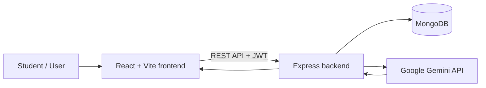

# InterviewAI — Placement Preparation Platform

InterviewAI is a full-stack web application that helps students practise job interviews, review their answers with AI-powered feedback, track their practice history, and improve their resumes.

**Live demo:** https://interview-ai-gen-black.vercel.app/

## Features

- **Account authentication:** Sign up and log in with protected application pages.
- **Practice interviews:** Practise HR, Technical, and Communication questions.
- **AI answer evaluation:** Get an overall score, answer-level feedback, strengths, improvement suggestions, and a sample improved answer powered by the Gemini API.
- **Dashboard and progress:** Review practice statistics and interview activity.
- **Interview history:** Revisit completed practice sessions and their evaluation results.
- **Resume review:** Upload a PDF or DOCX resume for AI-powered feedback, strengths, improvement suggestions, and an ATS-readiness estimate. This estimate is guidance only; it is not a score from a real ATS vendor and does not guarantee interview calls.

## Tech stack

| Layer | Technologies |
|---|---|
| Frontend | React, Vite, React Router, Tailwind CSS, React Icons |
| Backend | Node.js, Express |
| Database | MongoDB, Mongoose |
| Authentication | JWT, bcryptjs |
| AI | Google Gemini API |
| Frontend deployment | Vercel |

## Architecture



The Gemini API key must remain on the backend. Do not expose it through a `VITE_*` environment variable or commit it to Git.

## Project structure

```text
interview-ai-platform/
├── client/                  # React + Vite frontend
│   ├── src/
│   ├── .env.example
│   └── vercel.json
└── server/                  # Express API
    ├── config/              # Database connection
    ├── models/              # Mongoose models
    ├── routes/              # Authentication, interviews, resumes
    ├── services/            # AI interview evaluation
    └── .env.example
```

## Run locally

Install a current supported Node.js release and npm first. MongoDB and a Gemini API key are required for the complete feature set.

### 1. Clone the repository

```bash
git clone https://github.com/gaara2006/interview-ai-gen.git
cd interview-ai-gen
```

If the repository is private, GitHub access is required to clone it.

### 2. Configure the backend

Create `server/.env` using `server/.env.example` as the template:

```env
PORT=5000
MONGO_URI=your_mongodb_connection_string
JWT_SECRET=replace_with_a_long_random_secret
GEMINI_API_KEY=your_gemini_api_key
GEMINI_MODEL=gemini-3.5-flash-lite
CLIENT_URLS=http://localhost:5173,https://interview-ai-gen-black.vercel.app
```

Use your own MongoDB connection string, a strong random JWT secret, and your own Gemini API key. Keep this file private and never commit it. `CLIENT_URLS` is a comma-separated list of allowed frontend origins; include the actual deployed frontend origin.

Then install dependencies and start the backend in one terminal:

```bash
cd server
npm install
npm run dev
```

The API listens on port `5000` by default. Visiting `http://localhost:5000/` should return a backend status message when the server is running.

### 3. Configure the frontend

Create `client/.env` from `client/.env.example` and set the local API URL:

```env
VITE_API_URL=http://localhost:5000
```

Install dependencies and start Vite in a second terminal:

```bash
cd client
npm install
npm run dev
```

Open the local URL shown by Vite, normally `http://localhost:5173`.

### 4. Validate the frontend

From the `client` directory:

```bash
npm run lint
npm run build
```

## Deployment notes

### Frontend (Vercel)

- Deploy the `client` directory as the frontend project if that matches the current Vercel project configuration.
- Build command: `npm run build`
- Output directory: `dist`
- Set `VITE_API_URL` in Vercel to the public URL of the deployed backend API, without a trailing slash.
- The repository includes `client/vercel.json` to route frontend paths to the React application.

### Backend

Deploy the `server` directory to a Node.js-compatible hosting provider. Use `npm install` as the install/build step if required by the provider and `npm start` as the start command. Configure `MONGO_URI`, `JWT_SECRET`, `GEMINI_API_KEY`, `GEMINI_MODEL`, and `CLIENT_URLS` in the provider's environment settings. Add the exact Vercel site origin to `CLIENT_URLS` so the API's CORS policy allows browser requests from the frontend.

Never paste secrets into source files, README examples, screenshots, or public issue trackers. If a credential is accidentally exposed, rotate it.

## Notes and limitations

- AI feedback is generated from the written answers and should be treated as practice guidance, not a hiring decision.
- Resume review is an AI-generated aid; its ATS-readiness estimate is not a guaranteed result from an actual applicant-tracking system.
- AI features require a valid Gemini API key and may be affected by provider quotas, availability, or network errors.

## Current live application

https://interview-ai-gen-black.vercel.app/
